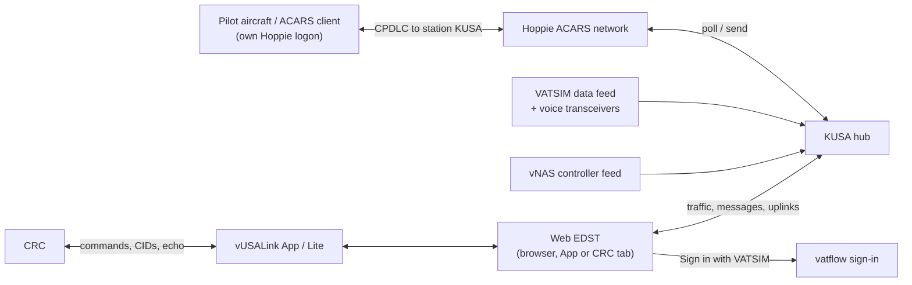

# vUSAlink EDST Manual

The complete guide to the vUSAlink EDST system: the web EDST at **[vatflow.io/vusalink/edst](https://vatflow.io/vusalink/edst/)**,
how it delivers CPDLC to VATSIM pilots, and the two Windows companions that connect it to CRC (**vUSALink App** and
**vUSALink-Lite**).

> This manual describes the system as of **v0.3.4 of vUSALink App (November 2026)**. The web EDST updates
> continuously. If something on screen differs from this manual, the page is newer.

## Contents

1. [The system at a glance](#1-the-system-at-a-glance)
2. [How CPDLC works](#2-how-cpdlc-works)
3. [For pilots: connecting to KUSA](#3-for-pilots-connecting-to-kusa)
4. [For controllers: getting started](#4-for-controllers-getting-started)
5. [The screen](#5-the-screen)
6. [The Aircraft List (ACL) row](#6-the-aircraft-list-acl-row)
7. [Menus: sending clearances](#7-menus-sending-clearances)
8. [The MCA: typing ERAM commands](#8-the-mca-typing-eram-commands)
9. [Working CPDLC traffic](#9-working-cpdlc-traffic)
10. [Other windows](#10-other-windows)
11. [Working from CRC: vUSALink App and vUSALink-Lite](#11-working-from-crc-vusalink-app-and-vusalink-lite)
12. [Practice: TEST MODE and VIEW ARTCC](#12-practice-test-mode-and-view-artcc)
13. [Troubleshooting and messages](#13-troubleshooting-and-messages)
14. [Reference](#14-reference)

---

## 1. The system at a glance

| Part | What it is | Where it runs |
|---|---|---|
| **Web EDST** | The controller's screen: an ERAM-style EDST with an Aircraft List, menus, an MCA and CPDLC logs. All EDST logic lives here. | Any browser, at vatflow.io/vusalink/edst/ |
| **KUSA hub** | The CPDLC server. It holds the single Hoppie station **KUSA**, works out which aircraft belong to which controller, and relays messages both ways. | Cloud server |
| **vatflow sign-in** | "Sign in with VATSIM". Proves who you are (your CID) to the hub. | vatflow.io |
| **Hoppie ACARS** | The network pilots' aircraft already use for CPDLC on VATSIM. | hoppie.nl |
| **vUSALink App** | Windows app: the web EDST in its own window, next to CRC, with CRC commands mirrored into it and EDST clearances typed back into CRC. | Your PC |
| **vUSALink-Lite** | Tray program for controllers who keep the EDST in a CRC browser tab. Mirrors CRC commands into that tab. | Your PC |

**Why a hub?** Hoppie only lets one program use a station callsign at a time, and browsers can't talk to Hoppie
directly. So one hub is "KUSA" for all of the US and shares the traffic out to every controller. **Controllers never
need a Hoppie logon code.**

---

## 2. How CPDLC works

### 2.1 Coverage and who owns an aircraft

- **US airspace** is every US ARTCC (the `KZxx` centers, plus Anchorage, Honolulu and San Juan). Oakland and New York
  Oceanic are not covered.
- **Airborne aircraft** (50 kt or more) belong to the ARTCC whose boundary contains them. Within 20 nm of a border,
  the neighbouring ARTCC sees them too, dimmed.
- **Aircraft on the ground** (under 50 kt) go to the ground list of the ARTCC they are in.
- **Your frequency wins over geography.** An aircraft tuned to your voice frequency is on your list wherever it is.
- **No re-logon between centers.** When an aircraft crosses into another ARTCC, the hub simply hands the CPDLC
  connection to that ARTCC. The pilot stays logged on to KUSA.

### 2.2 Logon

1. The pilot sends a CPDLC logon to **KUSA**.
2. The hub accepts it automatically (`LOGON ACCEPTED`). Exceptions:
   - The aircraft is more than 50 nm outside US airspace: refused with `OUTSIDE OF KUSA COVERAGE`.
   - A controller forced the aircraft off earlier: the request waits for a controller to accept it (see 9.2).
3. Then the pilot is told whether anyone is providing service:
   - A verified **center** covers their ARTCC, or they're tuned to a verified controller's frequency:
     `ATC COMMS ESTABLISHED. CPDLC SERVICES AVAILABLE.`
   - Otherwise: `CPDLC NOT IN USE UNTIL FURTHER NOTIFICATION`. When a center later comes online and verifies,
     connected aircraft automatically get the ESTABLISHED message.
   - Only a verified `_CTR` "staffs" an ARTCC. FSS, approach and tower positions don't.
4. If the last center leaves, or the aircraft flies into an unstaffed ARTCC: `ATC COMMS TERMINATED.`

### 2.3 Uplinks (controller → pilot)

- The EDST sends the clearance to the hub, which gives it a message number and sends it to the aircraft as KUSA.
- Clearances need a reply (**WILCO** / **UNABLE**). The EDST underlines what's waiting for that reply, and alarms
  if no reply comes within **2 minutes**.
- Up to 5 elements can be combined into one uplink (the uplink queue, 7.10).

### 2.4 Downlinks (pilot → controller)

- **WILCO, UNABLE, ROGER, STANDBY, AFFIRM, NEGATIVE** are matched to the uplink they answer and go to the
  controller who sent it, even if the aircraft has since moved on.
- **Requests** (climb, direct, deviation, voice contact, …) go to the controller who owns the aircraft. If nobody
  answers within 3 to 5 minutes, the hub replies `UNABLE. REVERT TO VOICE.` so the pilot isn't left waiting.
- If no controller covers the aircraft, requests are answered `UNABLE. CPDLC NOT IN USE UNTIL FURTHER NOTIFICATION`.
- Departure clearance requests are the exception: see 2.5.

### 2.5 Departure clearances (DCL)

A pilot on the ground can request a clearance (`REQUEST … CLEARANCE / CLR / DCL / PDC / PREDEP`). It reaches a
verified **DEL, GND or TWR** controller when the aircraft is within 5 nm of that controller's field, even with no
center online. Approach positions don't receive clearance requests. Controllers answer with the CLEARANCE panel
(7.7).

### 2.6 Leaving CPDLC

- **Pilot logs off:** the connection ends.
- **Aircraft leaves US coverage** (more than 50 nm out, on two checks in a row): it gets END SERVICE (or
  `OUTSIDE OF KUSA COVERAGE` if it never had service) and is disconnected. It must log on again to return.
- **Pilot disconnects from VATSIM:** the connection is dropped quietly.
- **Controller actions:** END SERVICE (soft, the pilot can log on again at once) or force logoff (the pilot must
  ask again and a controller must accept). See 9.2.

---

## 3. For pilots: connecting to KUSA

1. Set up your aircraft or ACARS client for **Hoppie CPDLC** with your own Hoppie logon code, as for any VATSIM CPDLC
   station.
2. Send a **CPDLC logon to `KUSA`**.
3. You'll get `LOGON ACCEPTED`, then either `ATC COMMS ESTABLISHED` (a controller is providing service) or
   `CPDLC NOT IN USE UNTIL FURTHER NOTIFICATION` (stay logged on: you'll get ESTABLISHED when a center comes online).
4. Answer every clearance with **WILCO** or **UNABLE**. Use STANDBY if you need time.
5. You don't need to log on again when you cross from one US center to another.
6. On the ground, you can request your departure clearance by CPDLC when a delivery, ground or tower controller at
   your field is online.
7. Log off when you leave US airspace, or the system will end service for you once you're 50 nm outside it.

Voice remains primary. If ATC instructs you by voice, follow voice.

---

## 4. For controllers: getting started

### 4.1 What you need

- A VATSIM account and a **live CPDLC position** on VATSIM:
  - **Full access:** `_CTR` and `_FSS`.
  - **Ground only:** `_DEL`, `_GND`, `_TWR`, `_APP`, `_DEP`. The ACL is locked to ground aircraft.
  - Other callsigns (ATIS, observers, …) can watch but not send CPDLC.
- A modern browser, or vUSALink App (section 11).

### 4.2 Sign in and verify

1. Open **https://vatflow.io/vusalink/edst/** and click **SIGN IN** (top right of the Aircraft List bar). Sign in
   with VATSIM. The chip then shows your CID and name.
2. Connect to VATSIM on your position. The hub finds your position, ARTCC and voice frequency from the live VATSIM
   data. You can't pick an ARTCC yourself. It can take up to about 30 seconds after you connect.
3. **Verify your position** (once per device; it lasts 30 days). Until you do, a bar under the toolbar shows what to
   do. The hub uses one of two methods:
   - **vNAS:** be logged in to vNAS (CRC) on the same CID, active on that position (not as an observer).
   - **Code:** put the code shown (for example `VUSA-AB12K`) anywhere in your VATSIM controller info / ATIS, wait about
     30 seconds, then you can remove it.
4. The mode badge turns **CONTROLLING**. You can now send CPDLC.

You can only be signed in from **one place at a time** per CID. A second browser is refused while the first is active.

### 4.3 The mode badge

| Badge | Meaning |
|---|---|
| **CONTROLLING** | Signed in, on a CPDLC position, verified. Everything works. |
| **vNAS VERIFY** | Signed in, but your position isn't verified yet (4.2 step 3). |
| **SIGN IN TO CONTROL** | Not signed in. You can watch an ARTCC (12.2) or practise (12.1). |
| **VIEW ONLY** | Watching only. |
| **TEST MODE** | Synthetic practice traffic. Nothing is sent. |

---

## 5. The screen

### 5.1 Top buttons

| Button | What it does |
|---|---|
| **↓ / MORE** | Shows a second row: **WIND** (winds aloft), **ALTIM SET** (altimeters), **MCA** (jumps to the MCA). |
| **ACL nn** | The Aircraft List and how many aircraft are on it. Click to close the Departure List. |
| **DEP** | Departure List (10.1). The number is the count of proposed departures. |
| **GPD** | Graphic Plan Display: your traffic as ERAM data blocks on a map, trial plans and conflicts (10.2). |
| **PLANS** | Plans Display: flight plan readouts, trial plans and amendments (10.9). |
| **WX REPORT** | METARs (10.5). |
| **SIG** | SIGMETs. Flashes and shows `SIG[n]` when there are new ones (10.3). |
| **NOT** | NOTAMs and TFRs. Flashes on new items (10.4). |
| **GI** | General Information messages between centers. Shows `GI (n)` when unread (10.6). |
| **CPDLC ADV** | Confirm/advisory messages for the selected aircraft (7.8). |
| **CPDLC HIST / MSGOUT / ALL** | Message logs: the selected aircraft's history, its uplinks only, or all datalink traffic. |
| **Clock** | UTC time. |
| **LINK** | Appears once vUSALink-Lite has connected. Teal = connected (11.3). |
| **MSG WAIT** | Lit while a pilot message is unread. Click to open it. |
| **LIST** | Opens the small CPDLC list window (10.8). |
| **CRC** | Switches to the compact CRC layout (5.4). |
| **⧉** | Copies the CRC-layout link, for adding the EDST as a CRC browser tab. |

**SAT COMM** is lit while the CPDLC (KUSA hub) connection is up. **ACL** shows how many aircraft are on the list;
clicking it closes the Departure List. **NON-ADSB** turns the GPD's non-ADS-B indicator (a coral A) on and off.
UA, KEEP ALL, STATUS and OUTAGE are shown for the ERAM look
and say "coming soon".

### 5.2 Aircraft List toolbar

| Control | What it does |
|---|---|
| **Plan Options...** | Posts the selected aircraft's flight plan in the Plans Display and opens its Plan Options menu (10.9). |
| **Hold...** | Hold instructions for the selected aircraft (7.9). |
| **Show / Show ALL** | After clicking an R/Y/A conflict box: shows that conflict (or all of that type) on the GPD. |
| **Sort...** | The list filter (below). Highlighted when not on the default. |
| **Clean Up** | Deletes your manual strips whose callsign isn't on VATSIM. |
| **ADD/FIND** | Type a callsign and press Enter: jumps to that row, or opens the add form for it if it isn't listed. |

**Sort filters:**

| Filter | Shows |
|---|---|
| **SHOW FREQ A/C** (default) | Aircraft tuned to your voice frequency. |
| **SHOW CPDLC ONLY** | Aircraft tuned to your frequency **and** logged on to KUSA. |
| **SHOW ALL A/C** | Everything in your ARTCC (plus the 20 nm border buffer). |
| **SHOW GROUND A/C** | Aircraft on the ground and logged on to KUSA, departing the airport(s) in the **DEP APT** box (blank = any in your ARTCC; `ATL` = KATL; several separated by commas). Ground positions are locked to this filter. |

Manual strips always show (except in CRC layout). Aircraft you've handed off drop off once they leave your frequency.

### 5.3 Status row

- **VATSIM** status: e.g. `hub KZJX · 42 a/c · 3 CPDLC · ZJX_23 133.300`.
- **CPDLC** status: the hub connection, and short messages such as `verify position to send`.
- **+ ADD A/C / DEL A/C:** add a manual strip (callsign, type, altitude, route; Enter saves, Esc cancels), or delete
  the selected manual strip (Delete key or right-click also work). Live VATSIM traffic can't be deleted.
- **REFRESH:** refresh traffic now (it refreshes every 15 seconds anyway).
- **MAP:** the CPDLC Map (all KUSA traffic and staffed ARTCCs) in a new tab.
- **TEST MODE:** practice traffic (12.1).
- **SOUND:** alert volume. 50% is normal, 0% mutes.
- **POSITION bar:** your position and frequency, and what the list is showing.

### 5.4 CRC layout (`?crc=1`)

A compact layout for a CRC browser tab or a small window: one short button bar, the list, the status row and the
MCA. In this layout the list shows **only aircraft logged on to CPDLC and tuned to your frequency**, and stays empty
until your frequency is known. Open it with the **CRC** button, or add `?crc=1` to the address. The **⧉** button
copies that link.

---

## 6. The Aircraft List (ACL) row

From left to right:

| Column | What you see | Click |
|---|---|---|
| **VCI** (green headset) | **Solid:** on your frequency and on CPDLC. **Faint:** on your frequency, not on CPDLC. **Flashing:** asking to log back on after you forced it off. Blank: not on your frequency. | Solid: **force logoff** (asks first). Flashing: **accept logon**. |
| **R / Y / A** | Conflict probe: **R** red, another aircraft within 5 nm and less than 1,000 ft; **Y** yellow, not used; **A** orange, within 3 nm of a special activity airspace you've activated. The number is how many. Bright = on cleared altitudes; dark = only if an uncleared altitude change happens. Letters in all three boxes mean the aircraft isn't probed: **S** probe stopped, **H** holding, **X** no position. | Left: select (for Show / Show ALL). Middle: show all of that type on the GPD. Right: acknowledge, stop or resume the probe, clear the hold mark. |
| **Flight ID** | A small box (white = on CPDLC), the CRC **CID** (only with vUSALink App or Lite), the **callsign** (white when on CPDLC), and **(sector)** when another sector owns the track in CRC. Then the message triangle: **▼** pilot message waiting (flashes red until read), **▶** handoff awaiting WILCO, **▲** other uplink awaiting WILCO (red after 2 minutes). **▶\|(11)** = an ERAM handoff typed in CRC (11.1). | The callsign opens the **HANDOFF** menu. A triangle opens the **MESSAGES** window. |
| **PA** | Not used yet. | |
| **Type** | Aircraft type and equipment suffix. A **coral** `/A` (or `/-` when there is no suffix) means the flight can't fly its route (see Route). | Right-click the coral suffix: acknowledge. |
| **Alt.** | Present altitude, then the assigned altitude in white when there is one. **Green underline:** awaiting WILCO. **Red underline:** no reply after 2 minutes. | Opens the **ALT** menu. A red underline: acknowledge it. |
| **Code** | Current squawk. If the flight plan's assigned code differs, it follows in **amber underline**. | The amber code: uplinks `SQUAWK nnnn` straight away. Elsewhere: the **CODE** menu. |
| **Hdg / Spd** | Live heading and **ground speed**, then the assigned heading or speed in white when there is one (`H270`, `280`, `M.79`), underlined while it awaits WILCO. A direct or new route ends an assigned heading; RESUME NORMAL SPEED ends an assigned speed; UNABLE removes either. | Heading: **HDG** menu. Speed: **SPD** menu. |
| **Route** | The route in ERAM form: `KRDU..ROA..EKN..IHD.NEST03.KPIT` (`..` between fixes, `.` next to an airway or procedure, airports by their ICAO id). After a direct-to it starts at the present position: `KRIC./.GVE.V38..KCLE`. Left of it, the **remarks indicator**: yellow `*` in a yellow box = flight plan remarks you haven't looked at, white `*` = seen. **Flight ineligible for route:** the route has Q or Y airways (need RNAV) or T airways (need GNSS) the equipment suffix can't fly. The suffix shows coral in front of the route and in the Type column, and a cyan box surrounds the route. Underlined while a route, direct, crossing, hold or clearance awaits WILCO. | Opens the **ROUTE** menu. Middle-click: flight plan readout. The `*`: shows the remarks (ICAO `STS/` reason for special handling, then `RMK/`) in place of the route; click again for the route. Right-click the coral suffix: acknowledge (it turns white and the box goes); a route the flight can fly clears it. |

- Click elsewhere on a row to select it (teal); click again to deselect. Many menus and the MCA act on the selected
  row.
- **Dimmed rows** are border-buffer aircraft from a neighbouring ARTCC that aren't on your frequency or working you.
- Click a column heading (Flight ID, Type, Alt., Code, Hdg/Spd, Route) to sort by it.
- The EDST uses the ERAM console font (ERAMv110). Characters it doesn't have fall back to the old EDST font.
- Remarks come from the VATSIM flight plan. `/V/`, `TCAS` and `SIMBRIEF` are left out, so most plans show no indicator. TFM protected segments (white chevrons) and preferential routes (cyan brackets) aren't shown: VATSIM has no data for them.

---

## 7. Menus: sending clearances

Every menu can be dragged by its title and closes with X or a click outside it. Common buttons:

- **UPLINK:** sends it by CPDLC now.
- **SCRATCHPAD / SPC:** adds it to the uplink queue, to send several elements as one message (7.10).
- **AMEND:** records it in the EDST **without** a CPDLC uplink, for aircraft not on CPDLC. In vUSALink App it is also
  typed into CRC as the ERAM command (11.2). With nothing selected, AMEND removes the last queued element.
- **Reasons:** PD (at pilot's discretion), TFC, IMM (immediately), RES (restricted airspace), EXP (expedite), WX.
  They're added to the end of the message.

### 7.1 ALT menu

- Pick a level (FL450 down to 060), or type one in the box (`350`, `FL350` or `35000`).
- **UPLINK** sends `CLIMB TO AND MAINTAIN FL350` / `DESCEND TO AND MAINTAIN` / `MAINTAIN`. Below FL180 it's in feet
  (`CLIMB AND MAINTAIN 8,000ft`).
- **PD**, **TFC** and the ▼ reasons: as above.
- **LOCAL TALT:** adds the destination altimeter (on automatically below FL180).
- **BLOCK / TO:** a block altitude (`MAINTAIN BLOCK FL240 TO FL260`). Block altitudes are sent by CPDLC only: they
  can't be typed in the MCA, and aren't typed into CRC.
- **TEMP:** marks it as a temporary (interim) altitude. The CPDLC message is the same; CRC gets `QQ` instead of `QZ`.
- **X RES:** crossing restriction (7.3).
- If you typed `QZ 350 <callsign>` in the MCA or CRC (without `/U`), the menu opens with 350 already selected, ready
  to UPLINK.

### 7.2 CODE menu

Type a 4-digit code (0 to 7). It's pre-filled with the flight plan's assigned code when that differs. **UPLINK** sends
`SQUAWK nnnn`.

### 7.3 Crossing restriction (X RES)

Pick a **fix**, then an **altitude**, **speed** and/or **time** (AT, AT OR BEFORE, AT OR AFTER), and optionally
**AND MAINTAIN**. Examples: `CROSS LUNNI AT AND MAINTAIN FL240`, `CROSS LUNNI AT 280KT`,
`CROSS LUNNI AT OR BEFORE 1530`.

### 7.4 HDG menu

Choose **LT** (turn left), **RH** (turn right), **NP** (fly heading, default) or **PH** (fly present heading), and a
heading. **UPLINK** sends `TURN LEFT HEADING 270`, `FLY HEADING 270` or `FLY PRESENT HEADING`.

### 7.5 SPD menu

- Opens in **Mach** at FL280 and above, knots below (the KT/MACH button switches).
- **+ / − / NP:** or greater, or less, exact.
- **UPLINK** sends `MAINTAIN 280KT`, `MAINTAIN 280KT OR GREATER`, `MAINTAIN MACH .79`, …
- **RNS:** `RESUME NORMAL SPEED`.

### 7.6 ROUTE menu

Click a route in the ACL. The menu follows ERAM's Route Menu (TI 6110.101 3.2.1.2).

- **Top:** callsign and type/equipment, then three mode buttons. The selected one is shaded, and the EDST remembers it.
  - **Trial Plan:** the change becomes a trial plan on the Plans Display (10.9). Nothing is sent.
  - **Amend:** amends the flight plan with no CPDLC. vUSALink App types it into CRC: `QU fix` for a direct,
    `AM <cs> RTE <route>` for a route. The result is posted on the Plans Display (`.AM`).
  - **Amend + Uplink:** the same amendment, plus the CPDLC clearance (`PROCEED DIRECT TO …` or
    `CLEARED TO KDST VIA …`). The amendment is only made once the uplink goes out. This mode shows the CPDLC options:
    DIRECT / WHEN ABLE / AT FIX / AT ALT (a conditional AT FIX or AT ALT direct is uplinked but not amended: CRC has
    no command for it), PD and the reasons (TFC, IMM, RES, EXP, WX), **WX DEV** (sends at once) and **CLEARANCE** (7.7).
    Opening the menu from a pilot's direct or route request starts in this mode.
- **Keyboard input:** the current route (from present position once airborne). Typing goes in front of it: type the
  new part ending at a fix of the current route (`KATL..BOBBY..WALET`) and the route carries on from there. Any other
  edit is taken as the whole new route. **Enter** (or clicking the selected mode again) sends it. You can start typing
  anywhere in the menu.
- **Include PAR / Append * / Append ⊕:** shown as in ERAM (the two Appends can't both be on) but they don't do anything yet.
- **Direct-to-Fix:** the ATC intended route (not editable). Airways the equipment can't fly (Q/Y without RNAV,
  T without GPS) are underlined in coral. Below it are the fixes ahead, 10 to a column, ending with the destination.
  Click one: a direct in the selected mode.
- **Apply ATC Preferred Route:** FAA preferred routes (the national Preferred Routes database) to the destination that
  start at the departure airport (aircraft on the ground) or at a fix still ahead. **ELIGIBLE** lists those that fit
  the flight's altitude, aircraft class (jet, turboprop, piston), equipment (RNAV) and hours. They are marked `→`.
  **ALL** adds the others; hover one to see why it isn't eligible. Click a route: it replaces the route from its first
  fix, in the selected mode.
- **Bottom:** **Flight Data** (posts the flight plan on the Plans Display), **Previous Route** (greyed when the route
  hasn't changed), **TFM Reroute Menu** (greyed: TFM reroutes will come from VATFLOW; then the menu shows
  "Pending Reroute" and the protected segment), **Exit**.

### 7.7 Departure clearance (CLEARANCE panel)

For aircraft on the ground (it warns if the aircraft is moving faster than 50 kt).

- Fields: **DEST**, **CDR** (pick a coded departure route; "ON FILE" marks the one matching the filed route),
  **ROUTE**, **CLIMB** (default `CLB VIA SID`), **EXPECT** (`EXP 350 10 MIN AFT DP`), **DEP FRQ**, **SQUAWK**.
- Options: **THEN AS FILED**, **+LOAD NEW RTE+** (on by default).
- **PILOT SEES** previews the message. The limit is **220 characters**; if it's too long, turn off +LOAD NEW RTE+ or
  shorten the route.
- **UPLINK CLEARANCE** sends it as one message, for example:
  `CLEARED TO THE KMCO ARPT … CLB VIA SID · EXP 350 10 MIN AFT DP · DPFRQ 125.25 · SQUAWK 4521 · +LOAD NEW RTE TO KMCO+`.

### 7.8 CPDLC ADV

For the selected aircraft: **CONFIRM ALT**, **CONFIRM SPD**, **CONFIRM ROUTE**, **REPORT BACK ON ROUTE**,
**ALTIMETER** (the destination altimeter), and **free text** (up to 220 characters). These start the 2-minute reply
timer like a clearance.

### 7.9 Hold (Hold... button)

- **LOCATION:** present position or a fix on the route. **DIRECTION:** 8-point picker. **TURNS:** left or right
  (default right). **LEG:** 1 minute, or 5 to 25 nm. **EFC:** defaults to now + 30 minutes.
- **HOLD** sends `HOLD AT LUNNI MAINTAIN FL240 INBOUND TRACK 090 RIGHT TURNS LEG TIME 1 MIN EXPECT FURTHER CLEARANCE AT 1530`.
  **AS PUBLISHED**, **CANCEL HOLD** and **UPLINK EFC ONLY** are also there.
- A holding aircraft shows **H** in its conflict boxes.

### 7.10 Uplink queue

SCRATCHPAD adds elements (up to **5** per aircraft) to the queue at the bottom. **UPLINK** sends them as one message;
**clear** empties it. The queue isn't kept if you reload the page.

### 7.11 HANDOFF menu (click the callsign)

- **CONTACT** a facility: the list shows online centers (yours first, then neighbours) and approach/departure, with
  frequency and distance. Sends `CONTACT JACKSONVILLE CENTER 133.300`. Tick **RADAR SERVICES TERMINATED** to add it.
- **MONITOR** (centers): `MONITOR JACKSONVILLE CENTER 133.300`.
- **UNICOM 122.800:** `MONITOR UNICOM 122.800`, then END SERVICE automatically after the WILCO.
- **END SERVICE:** ends CPDLC with this aircraft (it can log on again).
- After a CONTACT to **approach/departure**, END SERVICE is also sent automatically after the WILCO.

---

## 8. The MCA: typing ERAM commands

The **MCA** box sits at the bottom left (drag it anywhere; it remembers where). Type a command, press **Enter**.
**Esc** clears, **Ctrl+R** recalls the last command. If you leave out the callsign, the **selected row** is used.

### 8.1 Commands

| Command | Sends |
|---|---|
| `QZ 350 AAL123 /U` | Altitude: `CLIMB TO AND MAINTAIN FL350` (or descend / maintain). `350`, `FL350` and `35000` all work. Block altitudes (`240B260`) aren't accepted: use the ALT menu. |
| `QZ 350 AAL123` (no /U) | **Nothing.** Records the altitude in the EDST only, and the ALT menu opens with it selected. |
| `QQ 350 AAL123 /U` | Temporary altitude (same CPDLC message as QZ). |
| `QU LUNNI AAL123 /U` | `PROCEED DIRECT TO LUNNI` |
| `QS 090 AAL123 /U` | `FLY HEADING 090`. Also `LT 090`, `RT 090`, `PH` (present heading). |
| `QS /280 AAL123 /U` | `MAINTAIN 280KT` (80 to 400). |
| `QS /M.80 AAL123 /U` | `MAINTAIN M.80`. `/M80` works too. |
| `UC LUNNI A240 AAL123` | Crossing restriction `CROSS LUNNI AT AND MAINTAIN FL240`. `S250` = speed, `M.78` = Mach. Several aircraft: `AAL123/DAL45`. No /U needed. |
| `11 AAL123` | ERAM handoff to sector 11: puts **▶\|(11)** on the row; click it to send CONTACT with that sector's frequency. |

**Add a reason** anywhere after the command: `/PD`, `/IMM`, `/EXP`, `/TFC`, `/RES`, `/WX`. Example:
`QZ 350 AAL123 /U /EXP /TFC` → `CLIMB TO AND MAINTAIN FL350, EXPEDITE, DUE TO TRAFFIC`.

### 8.2 Responses

`ACCEPT` (green) means it was sent. `REJECT` (red) with a reason means nothing was sent:

| Reason | Meaning |
|---|---|
| `NO FLID` | No callsign typed and no row selected. |
| `REQUIRE /U` | QQ, QU and QS need `/U`. |
| `ILL ALT` / `ILL HDG` / `ILL SPD` / `NO FIX` / `ILL FIX` / `FORMAT` | The value or format isn't valid. |
| `ILL CMD` | Not a command the EDST knows. |
| `NOT AUTH` | You're not signed in and verified (4.2). |
| `NO TRACK` | That callsign isn't on the list or on VATSIM. |
| `NO CPDLC` | The aircraft isn't logged on to KUSA. |
| `SEND FAIL` / other | The hub refused it; the reason is shown. |

---

## 9. Working CPDLC traffic

### 9.1 Replies and timers

- After an uplink, the column (Alt., Code, Hdg/Spd or Route) is **underlined green** and **▲** (or **▶** for a
  handoff) shows next to the callsign.
- **WILCO / ROGER:** the underline clears and a rising chime plays.
- **UNABLE / NEGATIVE:** the underline clears and the assigned value is removed.
- **STANDBY:** logged; the timer keeps running.
- **No reply in 2 minutes:** the underline and triangle turn **red** and an alarm sounds. Click the red underline to
  acknowledge.
- Each WILCO is matched to the uplink it answers.

### 9.2 Logons

- Logons are **accepted automatically**. A chime plays when a newly logged-on aircraft appears on your list.
- **Force logoff:** click the solid VCI and confirm. The pilot gets END SERVICE and LOGOFF, and can't log back on until
  they ask and a controller accepts.
- **Accept a re-logon:** the VCI flashes and a three-tone alert plays. Click the VCI.
- **END SERVICE** (HANDOFF menu): a soft end. The pilot can log on again straight away.

### 9.3 Pilot requests

- A request makes **▼** flash on the row, lights **MSG WAIT** and plays a chime that **repeats every minute** until you
  open it.
- Click ▼ or MSG WAIT to open **MESSAGES**: the request (REQUEST DIRECT, CLIMB, DESCENT, BLOCK, WEATHER DEVIATION,
  VOICE CONTACT, …) and the history.
  - **UNABLE** or **STANDBY**: quick replies.
  - **OPEN MENU**: opens the ROUTE menu for direct/route/deviation requests, or the ALT menu.
  - **Free text** reply.
- Unanswered requests get `UNABLE. REVERT TO VOICE.` from the hub after 3 to 5 minutes.
- Messages from aircraft not on your frequency are logged without an alert.

### 9.4 Handoffs

1. Send **CONTACT** or **MONITOR** from the HANDOFF menu, or click **▶\|(sector)** after an ERAM handoff.
2. **▶** shows until the pilot WILCOs: "handoff acknowledged, awaiting frequency change".
3. The aircraft drops off your frequency-based list once it changes frequency. Its CPDLC connection stays with KUSA, so
   the next controller simply sees it on their frequency.
4. UNABLE to a handoff cancels it.

There is no CPDLC "next data authority" transfer: within the US, the hub moves the connection by itself.

### 9.5 Working a position with someone else

If two controllers work the same ARTCC, each sees the other's uplinks (marked **co-ctrl** in the log), and a WILCO
clears the pending marks for both.

### 9.6 Sounds

| Sound | When |
|---|---|
| Two beeps | New logon, or pilot message (repeats every minute while unread). |
| Rising two-tone | WILCO received. |
| Five quick beeps | No reply after 2 minutes. |
| Three tones | An aircraft asks to log back on. |

Sounds start after your first click on the page. The LIST window is always silent.

---

## 10. Other windows

### 10.1 DEP: Departure List

Proposed and connected departures from airports in your ARTCC, from 30 minutes ago to 2 hours ahead, refreshed every
30 seconds. **P** = `A` connected on VATSIM, `N` proposed only. Sort by P-time, destination, departure or callsign;
ADD/FIND filters.

### 10.2 GPD: Graphic Plan Display

The ERAM Graphic Plan Display (FAA TI 6110.101, chapter 5): your traffic as data blocks on a black map, with routes,
trial plans and conflicts. It is not radar. Open it with **GPD**; it stays open while you work the Aircraft List (it is
a window, not a pop-up). Drag the title bar to move it and the bottom-right corner to resize it. Closing it (Exit or
X) forgets the range and center, so it opens on your saved map (**Tools > Save GPD Map**) or the whole ARTCC.

**Data block** (up to five lines, with a leader line to the diamond position symbol and a direction-of-flight vector):

| Line | Shows |
|---|---|
| 0 | Alert counts in red, yellow and orange. White once every problem of that type is acknowledged; brown `X` / `S` / `H` / `F` when the flight isn't probed (no position, probe stopped, hold, frozen). Blank when there are none. |
| 1 | Callsign (reverse video when selected). |
| 2 | Altitude: `350C` in conformance with the assigned altitude, `350↑219` / `240↓310` climbing or descending to it, `290T242` with an interim altitude, `350219` / `230370` climbing or descending to a block, `230B350` inside the block, just the present altitude when nothing is assigned. |
| 3 | Destination (US airports without the K) and ground speed. |
| 4 | The flight plan altitude while climbing to an interim, or the block (`290B370`) while climbing or descending into it. |

The whole block is red or yellow when the aircraft has an unacknowledged red or yellow alert. **Suppress** shows only
the position symbol and altitude for aircraft that have no route on display (**Restore** brings the blocks back).
With **NON-ADSB** (top toolbar) on, a coral **A** sits on the far side of the symbol from the leader for aircraft whose
VATSIM flight plan equipment has no ADS-B.

**Clicking the data block**

| Field | Left-click | Middle-click | Right-click |
|---|---|---|---|
| Callsign | Select the aircraft (selects its ACL row too) | **Show All** on/off | |
| Line 0 alert count | Select it (for **Show**) | **Show** it | Conflict Acknowledge menu |
| Altitude | Altitude Menu (trial plan or amend, like the Plans Display) | | |
| Destination | Route Menu (direct-to fix, edited route) | | **Graphic Menu** |
| Ground speed | Speed Menu | | |
| Trial plan ID (second leader) | Select the trial (for Send AM / Send INT) | | Remove it from the GPD |

Trial plans made here open in the Plans Display too (10.9), and Plans Display trial plans are drawn here.

**Menu bar, first row**

| Button | What it does |
|---|---|
| **Plan Options...** | The selected aircraft's (or trial plan's) Plan Options: Altitude, Speed, Route, Previous Route, Stop/Resume Probe, Trial Departure, Resubmit, **Plans** (its plan in the Plans Display) and **Delete** (removes it from the GPD; not while it has red or yellow alerts). |
| **Hold...** | Hold Data Menu for the selected aircraft. |
| **Show** | Shows the selected alert: the two routes with the conflict segment. Again: removes it. |
| **Show All** | Shows the selected aircraft's route with all its alerts. Again: removes it. |
| **Graphic...** | Graphic Menu (below). |
| **Clean Up** | Removes route lines, trial plan routes and alert displays from the GPD. |
| **Send AM / Send INT** | Sends the selected trial plan as an amendment or an interim altitude, as in the Plans Display. |
| **Template...** | Amendment Template for the selected aircraft, or the Flight Plan Template. |
| **Exit** | Closes the GPD. |

**Menu bar, second row**

| Button | What it does |
|---|---|
| **Recenter** | Then click the map where the new center goes (Esc cancels). You can also drag the map. |
| **Range nnn** | The width of the map in nm. Click for 10 to 1000 or type a value; the mouse wheel over the button or the map changes it too. |
| **Suppress / Restore** | Limited or full data blocks (above). |
| **Map Options...** | **Map Features** (below) and the **AC Display Menu**: Aircraft List filter (on: only ACL aircraft; off: all traffic in the ARTCC), automatic data block offsetting, altitude filter limits, route preview time (0, 2, 5, 10 or 20 minutes of route ahead of every aircraft). |
| **Tools...** | **Airspace Status** (the SAAs in your ARTCC with floor and ceiling; alerting ones first in orange, then active ones marked `ACT`. SAAs are closed until you click one to activate it, and click again to close it. Right-click one to center the map on it), **Save GPD Map**, and Saved Map once saved. Airport Stream Filter Status, Options and Restrictions are grey (not on VATSIM). |
| **Saved Map** | Back to the saved range and center. |
| **Future Time** | 0 to 20 minutes ahead: drag the slider, click the bar to step a minute, middle-click to jump. Aircraft move along their routes at their ground speed; the title says `Future Time +n` and the window gets a wide white border. Alerts don't change. |

Under the buttons, the **range scale** shows five marks (for example 0 to 25 nm).

**Map Features:** sector boundaries (off, high, low), adjacent centers, approach control boundaries (dashed grey;
only where they're on file), Special Activity Airspace (orange while alerting) and labels, airports (box), NAVAIDs
(circle), waypoints (+), their labels, airways, and the range scale. Your own center is always drawn in bold white.
To keep the map readable, waypoints show at range 200 and below, airports and airways at 400 and below, NAVAIDs at 500
and below. Settings are kept in your browser.

**Routes** are drawn only when asked for: Show, Show All, the selected aircraft, route preview and trial plans
(dashed, with a second leader labelled `DAL123.T1`). Arrows along a route show the direction of flight; the conflict
part is drawn thick in red, yellow or orange.

**Graphic Menu** (5.2.2): a route trial plan drawn on the map. Select an airborne aircraft and click **Graphic...**
(or right-click its destination). Click points on the map (a dashed line follows them; **Undo point** takes the last
one back), then click the fix where the flight rejoins its route. The trial plan's route is the points as ERAM
latitude/longitude fixes (`3506/08204`), the rejoin fix and the rest of the route; it is probed, shown here and in the
Plans Display, and **Send AM** sends it as `AM DAL123 RTE 3506/08204..3511/08150..LVL..AML`. Include PAR, Append * and
Append ⊕ are grey (no adapted routes on VATSIM).

### 10.3 SIG: SIGMETs

SIGMETs within 125 nm of your ARTCC, refreshed every 90 seconds. New ones are tagged NEW: click each to acknowledge.
▶ shows the full text.

### 10.4 NOT: NOTAMs

Your ARTCC's TFR and airspace NOTAMs, refreshed every 90 seconds. Type an airport to add its NOTAMs (up to 10);
**DEST** adds the selected aircraft's destination. Filter, sort, and suppress items (for this session).

### 10.5 WX REPORT, ALTIM SET, WIND

- **WX REPORT:** METARs for up to 10 airports, with flight category. The selected aircraft's destination is added
  automatically.
- **ALTIM SET** (MORE): altimeters for up to 10 airports.
- **WIND** (MORE): winds aloft for the station nearest your traffic.

### 10.6 GI: General Information

Free-text notes (up to 500 characters) shared with your ARTCC and the neighbouring centers. Needs sign-in to read and a
verified position to send (SEND or Ctrl+Enter). Click a message to mark it read or delete it (on your screen only).

### 10.7 Conflict probe

Runs after every list update. It checks your aircraft against all traffic along the next 120 nm of route and alerts
only when two aircraft will be **within 5 nm and less than 1,000 ft apart**. Each aircraft climbs or descends from its
present altitude toward its assigned altitude (else its filed altitude) at 2,000 ft/min, so aircraft that will be
thousands of feet apart where their routes cross don't alert. It also checks special activity airspace, but only the SAAs
you've activated in GPD Tools > Airspace Status; they're closed otherwise. It's visual only (no sounds).

### 10.8 LIST window

A small, read-only window listing the aircraft **on your frequency and on CPDLC** (callsign and level). Made to sit
on top of CRC. It can't send anything and never makes sounds.

### 10.9 PLANS: Plans Display

The ERAM Plans Display (FAA TI 6110.101, chapter 6): flight plan readouts, **trial plans** probed for conflicts
before you commit to them, and **amendments**. Open it with **PLANS**; it also opens by itself when a plan is posted.
Drag the title bar to move it and the bottom-right corner to resize it. It closes when the last plan is removed.

**Posting a plan**

| Do this | Posts |
|---|---|
| Middle-click a **route** in the Aircraft List | The aircraft's **current plan** |
| Select an ACL row, then **Plan Options...** (ACL toolbar) | Its current plan, with Plan Options open |
| Middle-click a **route** in the Departure List | The **proposed plan** |
| Route menu → **PREVIOUS ROUTE**, or Plan Options → **Previous Route...** | The **previous route** (`.PR`) |
| Plan Options → **Altitude... / Speed... / Route...** in Trial Plan mode | A **trial plan** (`.T1`, `.T2` ...) |
| **Send AM**, **Send INT**, Amend mode, or the Amendment Template | An **amendment plan** (`.AM`) |

Entries are listed current plans first, then proposed, previous route, trial and amendment plans.

**What an entry shows**

- **Plan ID:** CID and callsign, plus the owning sector in parentheses when another sector owns the track. The
  CID is CRC's (learned from QF) or else the last three digits of the VATSIM CID. The ID turns red or yellow when the
  plan has a red or yellow problem.
- **Readout:** `TYPE BEACON SPEED FIX TIME ALT`, then the route. Airborne: FIX is the present position
  (`3455/8243`), TIME is `E` (now), ALT is the assigned altitude, and the route starts at the present position
  (`KATL./.3455/8243..LVL..AML..KIAD`, with the ETA when the route has coordinates). On the ground or proposed: FIX is
  the departure airport and TIME is the proposed time (`P1530`). Remarks follow in grey. The data comes from the
  VATSIM flight plan.
- **Trial and AM plans:** what changes, for example `AM 413 ALT 290 FIX 3834/8040 TIM E1305`, plus `RTE ...` for a
  route trial. A trial plan's box counts down from **5:00**; it is removed when it reaches zero.
- **Problems:** under a current or trial plan, one line per conflict: the other aircraft (or airspace), minutes to
  the conflict and its Zulu time, for example `N22T  5 min 1535Z (25)`. Red, yellow or orange as in the ACL;
  **NEW** for the first minute. Current plans use the ACL's conflict probe; a trial plan is probed with its own
  altitude, speed or route against traffic within 200 nm.
- **Coral `A`** left of the CID: not ADS-B equipped (no B1/B2/U1/U2/V1/V2 in the ICAO equipment).
- Brown lines: **Stop Probe** and "Aircraft not probed" reasons.

**Mouse**

| On | Left-click | Middle-click | Right-click |
|---|---|---|---|
| Plan ID | Select (menu bar buttons light up) | **Show All** on the GPD (again: removes it); a trial plan's route goes back on the GPD. Proposed plan: trial departure now | Delete the entry |
| Problem | Select it (for **Show**) | **Show** it on the GPD | Acknowledge (turns white); again to undo |

**Menu bar** (grey = not available for the selection)

| Button | What it does |
|---|---|
| **Plan Options...** | Altitude, Speed, Route, Previous Route, Stop/Resume Probe, Trial Departure, Resubmit, Delete (below). |
| **Show** | Shows the selected problem on the GPD. |
| **Show All** | Shows the selected flight (its row selected) on the GPD. |
| **Send AM** | Sends the selected trial plan as an amendment: the trial is replaced by an `.AM` entry. |
| **Send INT** | Sends the trial altitude as an **interim** altitude (`QQ`). |
| **Tools...** | Restrictions: always grey (VATSIM has no adapted restrictions). |
| **Template...** | Nothing selected: Flight Plan Template. A plan selected: Amendment Template (below). |
| **ICAO** | Adds the ICAO flight plan data (FPL fields 7 to 18) under the selected current or proposed plan. |
| **Clean Up** | Removes all trial, current, proposed, previous route and accepted amendment plans. |

**Plan Options menu**

- **Altitude...** List 600 to 010 or type a value and press Enter. **Trial Plan** (default) makes a trial plan;
  **Amend** amends straight away. **INT** makes it an interim altitude.
- **Speed...** Knots (TAS), `+20` / `-20` from the current value, or Mach `.78` / `+.02`. Trial Plan or Amend.
- **Route...** Edit the route and press Enter (Shift+Enter for a new line), or click a **direct-to fix**.
  Trial Plan or Amend. A route that ends at a different airport asks first (**AM Change Destination Menu**).
- **Previous Route...** Shows the route before the last change and posts it as a `.PR` entry; **Apply Previous
  Route** amends back to it. Greyed until the route has changed while the EDST was open: a pilot refile, a route
  amendment from here or the ACL Route Menu (Amend or Amend + Uplink), or a CRC amendment that reached VATSIM.
- **Stop Probe... / Resume Probe:** stop conflict alerts at the present position or at a fix ahead (the stop starts
  when the aircraft passes the fix). It shows brown in the ACL and here, like the ACL's ack menu.
- **Trial Restrictions...** Always grey (no restrictions on VATSIM).
- **Trial Departure...** Proposed plans: a trial plan at a new departure time. **+ / -** move a minute; **P Time**
  uses the filed time (grey once it has passed); type HHMM (more than 30 minutes ago means tomorrow); **Create TP**.
- **Resubmit:** re-probes a trial plan under a new number. **Delete:** removes the entry.

A trial plan made from another trial plan keeps that trial's other changes, so you can trial an altitude and then
add a route to it.

**Templates**

- **Amendment Template:** AID, TYP, BCN, SPD, ALT, RTE and RMK, filled in from the flight plan. Change fields and
  press Send (or Enter). Only the fields you changed are sent.
- **Flight Plan Template:** fill in AID and RTE (and TYP, ALT); Send adds an EDST flight strip to the Aircraft List.
  CRC has no command that creates an IFR flight plan, so nothing is typed into CRC.

**What an amendment does**

The EDST takes the change itself (assigned altitude, previous route), and in **vUSALink App** the app types it into
CRC, one command per field (CRC's `AM` takes one field at a time):

| Change | Typed into CRC |
|---|---|
| Altitude | `QZ 290 AAL123` (INT / Send INT: `QQ 290 AAL123`) |
| Direct-to fix | `QU LVL AAL123` |
| Route | `AM AAL123 RTE KATL.PENCL3.PENCL..SOT` |
| Speed (knots) | `AM AAL123 SPD 450` (filed speed; Mach isn't typed) |
| Type | `AM AAL123 TYP B738/L` |
| Beacon | `AM AAL123 BCN 1301` |
| Remarks | `AM AAL123 RMK ++NEW PILOT++` (blank clears them) |

The `.AM` entry lists each line typed and **ACCEPT**. It goes away by itself after 30 seconds. **NOT SENT** (or a
"not typed" line) stays until you delete it: outside vUSALink App nothing is typed into CRC (an altitude is still
set in the EDST), and the app types only letters, digits, spaces and `. / + -`, so remarks with other characters
aren't typed. A track another sector owns asks first (**Eligibility Menu: Override and Send / Don't Send and Exit**).
Amendments don't send CPDLC; use the ACL menus or the MCA to uplink.

**Amended routes stay in the EDST.** A direct or reroute (from here, the GPD, the ACL route menu, or `QU … /U`)
changes CRC's flight plan, but the VATSIM data the EDST draws from usually doesn't change (a `QU` never does). So the
EDST keeps the new route itself, like an assigned altitude: the ACL route, the GPD route line and the plans here all
show it. When the VATSIM flight plan changes (a pilot refile, or vNAS passing the amendment on), VATSIM's route takes
over again. A kept route is dropped after 6 hours.

Not on VATSIM, so not in this Plans Display: adapted restrictions, TFM reroutes, AAR/PAR in routes, the Equipment
and More templates, non-basis plans.

---

## 11. Working from CRC: vUSALink App and vUSALink-Lite

Both are free Windows programs from this repository's **[Releases](../../releases)**. Use **one** of them:

| | vUSALink App | vUSALink-Lite |
|---|---|---|
| EDST shown in | Its own window | A CRC browser tab (or any browser) |
| CRC → EDST (commands, CIDs) | Yes | Yes |
| EDST → CRC (CRC ECHO, AMEND) | Yes | Not yet |
| Updates | One click (UPDATE button) | One click (tray menu) |

Full details: [README](README.md).

### 11.1 CRC → EDST: mirroring

With **CRC MIRROR** on, commands you type in CRC with `/U` go to the EDST as CPDLC uplinks, and CRC still gets the
normal command (without the `/U`):

| Typed in CRC | Result |
|---|---|
| `QZ 350 AAL123` | CRC amends the altitude; the EDST records it and the ALT menu opens with 350 selected. Nothing sent. |
| `QZ 350 AAL123 /U` | CRC amends; the EDST uplinks `CLIMB TO AND MAINTAIN FL350`. |
| `QQ` / `QU` / `QS … /U` | CRC gets the command; the EDST uplinks it. |
| `UC LUNNI A240 AAL123` | The EDST uplinks the crossing; the line is cleared from CRC (CRC has no UC). |
| `11 AAL123` | CRC hands off; the EDST row gets **▶\|(11)** to send CONTACT by CPDLC. |

You can use the **CID** instead of the callsign (`QZ 350 413 /U`), once the app has learned it (below).

**CIDs:** when you QF an aircraft, or middle-click its data block, the app reads CRC's readout and learns the CID.
The EDST then shows the CID to the left of the callsign, and `(sector)` when another sector owns the track.

### 11.2 EDST → CRC: CRC ECHO and AMEND (vUSALink App)

- **CRC ECHO** (top bar toggle): every clearance you uplink from the EDST is also typed into CRC, so CRC's flight data
  matches:

  | EDST | Typed into CRC |
  |---|---|
  | Altitude | `QZ 350 AAL123` (TEMP → `QQ`; block altitudes aren't typed) |
  | CODE | `QB 4521 AAL123` |
  | Heading | `QS 270 AAL123` |
  | Speed (knots) | `QS /280 AAL123` |
  | Direct / when able | `QU LUNNI AAL123` |
  | New route | `AM AAL123 RTE KJFK.LINND3..CHUBY…` |

- **AMEND** (any menu): the same CRC command **without** a CPDLC uplink, for aircraft not on CPDLC. Works with ECHO off.
- **Plans Display amendments** (Send AM, Send INT, Amend mode, Amendment Template) are typed the same way, also with
  ECHO off; they add `AM ... SPD / TYP / BCN / RMK` (table in 10.9).
- The app briefly brings CRC's ERAM window to the front to type (about 0.2 s), then gives focus back. It types into
  the ERAM window you used last. It won't type over a command you're half-way through in CRC.
- Not echoed (CRC has no typed form): Mach, present heading, +/− speeds, crossing restrictions, holds, clearances.

### 11.3 vUSALink-Lite and the CRC tab

1. Run **vUSALinkLite.exe** (it lives in the tray; you can set it to start with Windows).
2. In CRC, add a browser tab with the EDST CRC link (the **⧉** button copies it).
3. The **LINK** chip in the EDST turns teal: CRC commands now reach that tab.

---

## 12. Practice: TEST MODE and VIEW ARTCC

### 12.1 TEST MODE (signed out)

Click **TEST MODE** while signed out. You get six synthetic aircraft, all on CPDLC: four on the ground at KATL
(DAL1234, AAL892, SWA455, JBU701) and two airborne (UAL219, FDX1290). Every menu, the MCA and the clearance panel work.
**Nothing is sent**: simulated pilots reply WILCO after a few seconds, sometimes STANDBY first, and occasionally UNABLE
to a departure clearance. Signing in turns TEST MODE off.

### 12.2 VIEW ARTCC (signed out)

Type an ARTCC in **VIEW ARTCC** (for example `KZJX`) and press Enter to watch its traffic, which aircraft are on KUSA,
and its CPDLC traffic in CPDLC ALL. Nothing can be sent.

---

## 13. Troubleshooting and messages

| You see | Do this |
|---|---|
| `CID … is not currently controlling a CPDLC position on VATSIM … try again in ~30s` | Connect to VATSIM on a CPDLC position (4.1). The hub checks every 30 seconds. |
| `vNAS VERIFY` badge / `verify position to send` | Verify your position (4.2 step 3): vNAS login on the same CID, or the `VUSA-…` code in your controller info. |
| `Add VUSA-XXXX to your VATSIM controller info …` | Put that code in your controller info / ATIS and wait about 30 seconds. |
| vNAS messages (`not found in vNAS`, `session is not active`, `observer sessions cannot send CPDLC`, `ARTCC/callsign does not match`) | Your vNAS login must be active, not an observer, on the same position as your VATSIM connection. |
| `CID … is already signed in from another session` | Close the EDST in your other browser or window, or wait a minute. |
| `NOT AUTH` / `sign in required` | Sign in (4.2). |
| `NO CPDLC` | The aircraft isn't logged on to KUSA. Ask the pilot to log on, or use voice (and AMEND). |
| `hub unreachable` / `proxy offline` | The hub can't be reached. Check your internet; it retries by itself. |
| The list is empty | Check the **Sort** filter. In the default FREQ filter the list stays empty until your voice frequency is known. |
| An aircraft you expect isn't on the list | Try **SHOW ALL A/C**, or check it's tuned to your frequency. |
| `relay failed` | Hoppie refused the message. Try again. |
| vUSALink App: `NOT SENT TO CRC (…)` | The clearance went out; only the CRC copy wasn't typed, for the reason shown. Type it in CRC yourself. |
| vUSALink App / Lite: CRC commands aren't mirrored | If CRC runs **as administrator**, start it normally (Windows hides its keys otherwise). |

---

## 14. Reference

### 14.1 Timings

| What | How often / how long |
|---|---|
| Traffic refresh | 15 s (LIST window 4 s) |
| CPDLC message check | every 2.5 to 4 s |
| Reply timeout (red, alarm) | 2 min |
| Unanswered pilot request → `REVERT TO VOICE` | 3 to 5 min |
| Unread message chime repeat | 1 min |
| ERAM handoff marker (▶\|) expires | 15 min |
| Position verification lasts | 30 days per device |
| Sign-in renews | every 6 h |
| DEP list, ground list | 30 s |
| SIGMETs, NOTAMs | 90 s |

### 14.2 Limits

| What | Limit |
|---|---|
| Uplink queue | 5 elements per aircraft |
| Departure clearance | 220 characters |
| Free text (ADV) | 220 characters |
| GI message | 500 characters |
| Coverage | US ARTCCs + 50 nm |
| Ground / airborne split | 50 kt |
| Border buffer (neighbour sees you dimmed) | 20 nm |

### 14.3 Saved in your browser

Manual strips, assigned altitudes, settings (filter, volume, VIEW ARTCC, …), the MCA position, your 30-day verification
and your sign-in. **Not** saved across a reload: the CPDLC logs, the uplink queue, pending headings/speeds, reply
timers, handoff markers and learned CRC CIDs (the app keeps its own copy of CIDs).

### 14.4 Links

- Web EDST: https://vatflow.io/vusalink/edst/
- CRC layout: https://vatflow.io/vusalink/edst/?crc=1
- CPDLC Map: https://vatflow.io/cpdlc-map.html
- vUSALink App and Lite: [Releases](../../releases) · [README](README.md)
- CRC ERAM commands: https://docs.virtualnas.net/crc/eram
